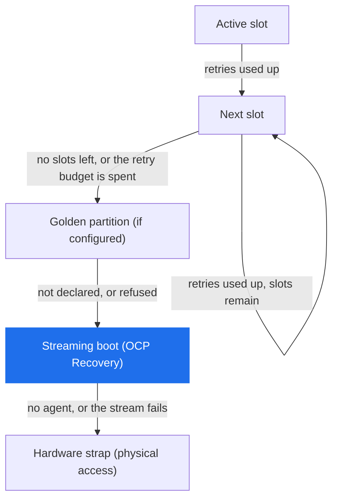
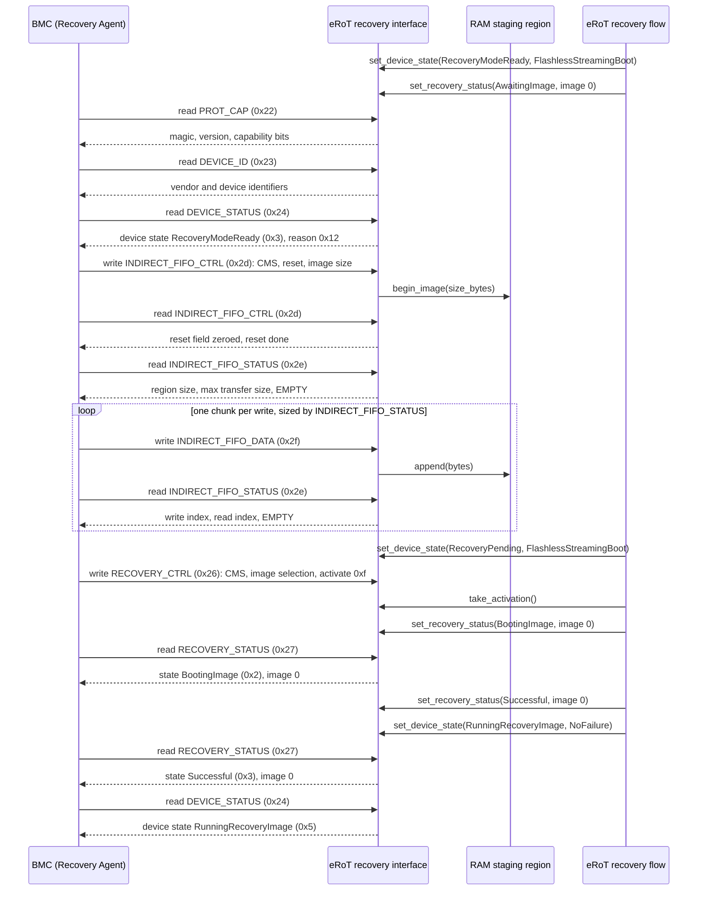
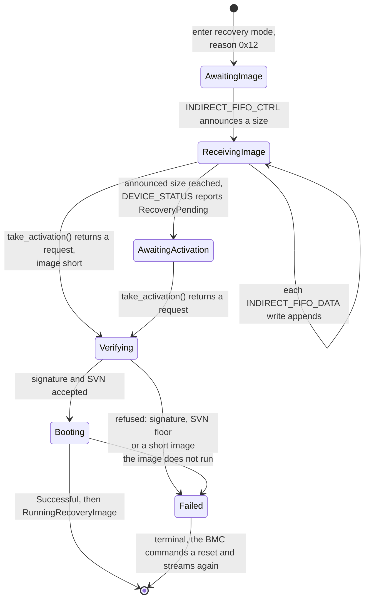
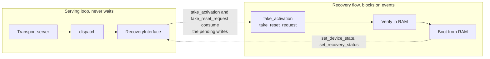

# OCP Recovery Streaming Boot

The eRoT serves the OCP Recovery interface as the Device, and the BMC
drives it as the Recovery Agent. The Recovery Agent pushes the bytes
and requests the activation, and the Device verifies the image and boots
or refuses it.

Streaming boot sits below every local image option on the board.
The eRoT tries the active slot with its retries, then whatever local
rungs the board declares, and streams an image from the BMC only when the
local options are gone. These rungs are the boot selector the eRoT runs
on itself, not the `Recovery` capability the orchestrator drives for
managed devices, and the orchestrator never recovers the eRoT itself.
Which rungs exist is per-board configuration rather than a rule this
design fixes, and the image layout schema permits a golden copy.

The strap stays the bottom rung. The chip samples a pin at power-on and
the ROM boots from a source other than the normal flash image.
Which pin and which source is per-chip, and reaching the strap means
someone touches the board.

The transport binding is out of scope here, with I3C and USB the
primary interfaces. This design covers the device layer below any of
them, so the serving function `dispatch` in
`services/ocp-recovery/server` takes a command byte and a payload and
leaves the framing to the transport server.

## The wire layer

`services/ocp-recovery/api` holds the wire layer: the command byte values
`0x22` through `0x2f`, the access rule, the accepted length and the scope
for each one, and a packed layout per register. `apply_agent_write`
validates every byte of a write before storing any. A refused write
leaves the OCP register unchanged. The crate defines `OCP RECV` as the
`PROT_CAP` magic and version 1.1, which the Device advertises. Every
value in this document follows OCP Secure Firmware Recovery 1.1.

`services/ocp-recovery/server` holds the registers and the dispatch
function. `RecoveryInterface` holds the single copy of the register
state, `dispatch` serves one Recovery Agent read or write against it, and
`FifoSink` is the seam the streamed bytes leave through. `RamStaging<N>`
implements the seam over a fixed buffer and implements `ByteSource` from
`util/io` for the read side. The verifier and the board staging region
already read through `ByteSource`, so a staged image needs no adapter.

`services/ocp-recovery/tests/agent_sequence_host.rs` drives the wire
side from the Recovery Agent against `RecoveryInterface` and pins the
register semantics the diagrams below describe. The test writes the
status registers itself, standing in for the verifier and the boot.

## The streaming-boot sequence

The eRoT does not tell the BMC it entered recovery mode. The Device
answers commands on this interface and raises no interrupt, so the
Recovery Agent discovers recovery mode by polling: `DEVICE_STATUS`
answers `RecoveryModeReady` with the reason, and the heartbeat field
advances while the Device runs, so the agent sees whether a Device that
reports the same status is still waiting for bytes or has stopped. When
the BMC starts polling is platform policy, outside this design.

The serving loop and the main flow of the firmware that serves the
registers run as separate execution contexts. The interface
and the RAM staging are objects the serving loop writes inside each
`dispatch` call, so every arrow the BMC starts is work the serving loop
does, including the one it passes on to the staging. The arrows the
recovery flow starts run in the main flow, which blocks on
`take_activation` while the serving loop keeps answering the BMC. The
BMC polls, so a read that lands before a recovery-flow update returns
the older value, and the diagram shows the poll that lands after.

The agent-sequence host test (`agent_sequence_host.rs`) drives the
agent half of this sequence, plus the error and heartbeat polls the
diagram leaves out. It streams an image in chunks the size the FIFO
advertises, checks the write and read indices after every chunk, and
ends on the same two terminal reads, with the status writes the flow
will make standing in for the flow.

The agent paces the push by reading `INDIRECT_FIFO_STATUS` after every
chunk and watching the EMPTY bit. The spec also lets an agent pace on a
NACK, or on the gap between the write index and the read index, and an
agent that keeps inside the max transfer size may push without reading
at all. The `dispatch` call copies each chunk into staging while it
handles the `INDIRECT_FIFO_DATA` write that carried it, so the FIFO
reads empty with both indices equal after every push and no second
consumer has to run first.

## What happens to the streamed image

The eRoT verifies the streamed image in RAM and boots it from RAM, as
the Caliptra implementation this port starts from does. Caliptra
verifies the streamed image in SRAM and boots it without persisting it.

Writing a fresh image into a redundant partition is a flash install.
This design never writes flash, so that path stays out. Booting an image
that already sits in a redundant or golden partition writes nothing, so
it stays in. That boot is a local rung of the ladder above, and the boot
selector takes it without the BMC.

The eRoT writes nothing to flash and runs no trial boot. The recovery
path reads the SVN floor to judge the image and never advances the floor,
because a recovery boot is not an installation. If the booted image
fails, the BMC commands a reset over `DEVICE_RESET` and streams again,
because a RAM image has no slot to revert to. The flow takes that
command with `take_reset_request` and performs it through `SelfReset`,
the capability
that already resets the eRoT when its own update activates. No trial
boot runs, so `DeviceTrialBoot` stays out of this path. A trial record
judges an installed image, and the recovery flow installs none.

The verify step runs through `IncrementalVerifier`. The flow starts a
session and polls it over the staged bytes as a `ByteSource`, and an
`Authenticated` outcome carries the `AuthenticatedImage` that reports
the SVN. The flow compares that SVN against the SVN floor the eRoT keeps
for itself, which `ErotUpdate` names as `SvnFloor`, not against the SVN
floor the orchestrator reads for a managed device. The flow calls
`floor` and never `advance`.

Proposed mapping from the verify outcome to the two status registers;
the spec leaves the reason code to the Device, so the mapping is open to
review:

| Verify outcome | RECOVERY_STATUS state | DEVICE_STATUS state and reason |
| --- | --- | --- |
| Image authenticates and boots | `Successful` (0x3) | `RunningRecoveryImage` (0x5), no reason code |
| Signature does not verify | `AuthenticationError` (0xd) | `BootFailure` (0xe), `RecoveryFirmwareAuthFailure` (0xf) |
| Image SVN below the SVN floor | `Failed` (0xc) | `BootFailure` (0xe), `RecoveryFirmwareRollback` (0x10) |
| Image malformed or short | `Failed` (0xc) | `BootFailure` (0xe), `RecoveryFirmwareMissing` (0xe) |
| Device cannot enter recovery | `EnterRecoveryError` (0xe) | `BootFailure` (0xe), `GenericHardwareError` (0x1) |

Only `RecoveryModeReady`, `RecoveryPending` and `BootFailure` carry a
reason code, and the interface stores 0 for every other state. The last
row reports the failure through `BootFailure` rather than `FatalError`.
The spec calls a fatal error not recoverable through the OCP flow and
populates no reason code for it, so a Recovery Agent reading `FatalError`
stops pushing images, while `BootFailure` carries the reason code that
says what to fix.

The Recovery Agent clears a terminal state with the `DEVICE_RESET`
command, and the eRoT takes the request through `take_reset_request` and
resets itself. The Recovery Agent never writes `RECOVERY_STATUS`,
because the command is read-only on the wire, so only the Device moves
that register.

## The execution model

The operational image runs the recovery sequence as its main flow. There
is no separate recovery service and no event-driven state machine. The
flow runs straight through and blocks on `take_activation` and
`take_reset_request`, while the transport loop underneath keeps serving
`dispatch`.

The wire half and the policy half are split, so the recovery flow can
block without stalling the BMC:

The BMC polls `DEVICE_STATUS` and `INDIRECT_FIFO_STATUS` and watches the
heartbeat for as long as the flow runs, so the wire half must not block
on the policy half. Caliptra can spin on the same registers in a
blocking loop because hardware serves them: the I3C core answers the
BMC whatever the firmware does. On the eRoT the firmware is what
answers, so the recovery flow cannot spin. It blocks on events while the
serving loop keeps answering, and `tick_heartbeat` shows the BMC that
the Device is alive.

Caliptra behaviours that follow from its silicon do not carry over: the
DMA shim that moves FIFO bytes, reads from a fixed FIFO
address, the dummy mailbox lock, and hashing over AXI. `RecoveryInterface`
is firmware state, so the bytes arrive on the same call that carries
them.

Until a streamed image verifies and boots, the image serving the
interface holds every downstream device in reset through
`BootControl::hold_in_reset`. Beyond serving the interface, the image
holds those resets and does nothing else.

## Which image serves the interface

The operational image serves the interface. It carries a degraded OCP
mode
that it enters on fatal paths the firmware itself detects, such as a
failed bring-up, and serving the interface after a fatal error is best
effort from possibly corrupted state.

Whether a board serves OCP streaming at all is board configuration,
declared in the board target next to the device table and checked by a
const function at build time. The `PROT_CAP` capability bits, the FIFO
region size and whether an image enters the serving flow all derive from
that declaration at compile time, so a board that declares nothing
builds no serving flow and has no bits to get wrong at run time.

This design does not serve the interface from the ROM, because the ROM
is fixed silicon and takes no firmware this project builds. Whether a
second image serves the interface as well is the open question below.

## The scope rule and the protocol-error latch

Every command carries a scope. Commands `0x22` through `0x27`, which are
`PROT_CAP`, `DEVICE_ID`, `DEVICE_STATUS`, `DEVICE_RESET`, `RECOVERY_CTRL`
and `RECOVERY_STATUS`, are always available. Commands `0x28` through
`0x2f`, which are the hardware status, the indirect window (`0x29` to
`0x2b`), the vendor command (`0x2c`) and the FIFO group (`0x2d` to
`0x2f`), are available once the recovery interface is active, which
`DEVICE_STATUS` byte 0 reports as any non-zero value. The agent reaches
the FIFO group only when `PROT_CAP` bit 12, FIFO CMS support, is set.

`dispatch` refuses a scoped command while `DEVICE_STATUS` byte 0 reads
zero and latches a protocol error. The spec requires an error only on an
unsupported command, so this refusal is stricter. Before the Device
enters recovery the FIFO registers carry no image size, no indices and
no staged bytes, and an agent that reads them learns nothing.

A refusal changes no register except the error byte it latches.
`dispatch` validates access, length and every byte of the payload before
storing anything, latches a protocol error into `DEVICE_STATUS` byte 1,
and answers zero bytes. The latch clears when the Recovery Agent reads
`DEVICE_STATUS`, and the read returns the error that was latched before
the clear. A second error arriving before that read overwrites the first,
so the Recovery Agent sees the most recent one.

The values are the `ProtocolError` bytes in `services/ocp-recovery/api`.

"Write 1, Device Clears" works on the whole field. The activate field
in `RECOVERY_CTRL` takes `0xf` to activate and `0x0` for idle and
refuses every other value, the FIFO reset field and the device reset
field follow the same rule, and the Device writes the idle value back
once it has acted.

## Out of scope

Forced recovery is out of scope. Caliptra does not implement it, and
adopting it later costs a configuration field plus the operational image
serving the registers. The interface decodes the forced-recovery value
the agent writes and keeps it across the reset take, so the wire layer
stays as it is.

Multi-stage activation is out of scope. The spec has the Device
increment the recovery image index and return to awaiting an image when
a further stage follows a successful activation, so an agent streams one
stage after another. The eRoT streams one image and boots it, and the
flow reports image 0 throughout. The register file carries the index
field, so adopting stages later costs the flow a counter rather than a
wire change.

Also out of scope: the indirect memory window and the vendor command,
which `dispatch` refuses and `PROT_CAP` does not advertise, and the
transport binding.

Downstream devices are out of scope. The interface reaches the eRoT and
nothing below it.

## Open questions

**Must streaming boot cover the case where the operational image does
not run at all, without physical access?** Nothing inside that image can
serve the interface when it does not run, so the ROM rejecting a corrupt
image, a torn update and slots stranded below the SVN floor all fall
through to the strap and a technician.

A yes means a second signed image, a recovery copy in its own flash
region with its own composition, reached by a hardware boot fallback
when the operational image never signals liveness. It costs a second
binary to sign, provision and write-protect, a policy for rewriting a
write-protected copy, and the platform capabilities behind it: a boot
fallback the hardware starts before the ROM runs, flash write protection
the hardware locks until a reset, and a ROM anti-rollback counter, which
is not the `SvnFloor` the firmware reads, kept at or below the revision
of the recovery copy. The second image also needs a decision on what it
contains: a full firmware carrying the degraded mode, a minimal
recovery-only image, or a per-board choice.

A no leaves the operational image as the only image that serves the
interface, and the cases above reach a technician.

Smaller questions:

- What update policy governs the recovery copy? Rewriting it means
  lifting the write protection, which is the same capability an attacker
  needs, so who may do it, with what authorization and in what setting is
  a platform decision this design does not take. The policy also has to
  keep the ROM anti-rollback counter at or below the revision of the
  recovery copy, or rewrite the recovery copy before advancing the
  counter.
- How does the BMC reset the eRoT when the booted image stops serving the
  interface? The in-band `DEVICE_RESET` needs a serving dispatch, so this
  case needs board wiring, either a BMC-driven pin that fires the boot
  fallback or a reset line that reaches the eRoT.
  Without one of the two the case falls through to the strap.
- Does the ROM failure path leave the fallback watchdog counting, so a
  refused operational image reaches the recovery copy without help? One
  bench test per board answers it.
- Where does streaming boot sit in the ladder? The diagram puts it under
  every local rung and above the strap, which suits a board whose local
  images are all exhausted before the BMC is asked for bytes. A board
  that trusts the BMC more than a stale golden copy would order them the
  other way, and the order is per-board configuration either way.
- May a platform that has latched `LockdownLatch` serve the interface?
  The latch is one-way and terminal, so a streamed image that runs
  afterwards undoes the safe state the latch put the platform in. Either
  the degraded mode stays out of the latched path, or the latch gains a
  stated exception.
- Forced recovery stays out of scope unless review raises it.
