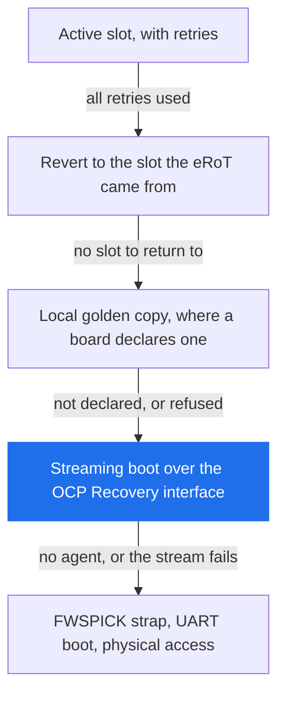
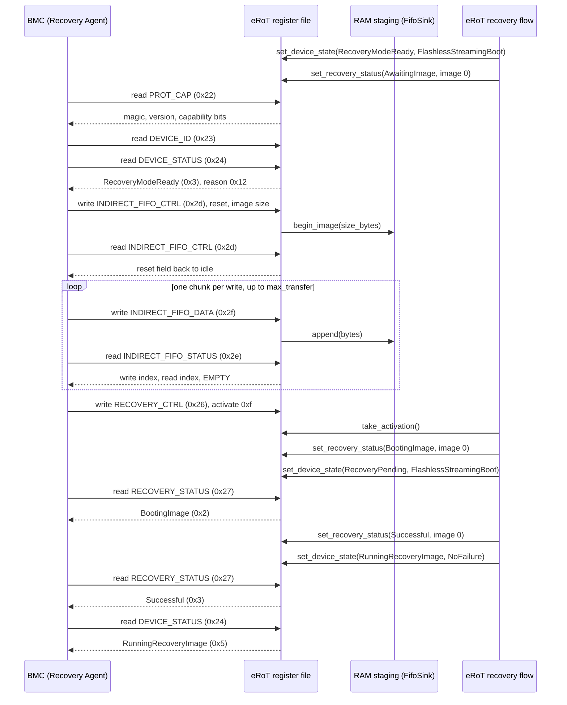
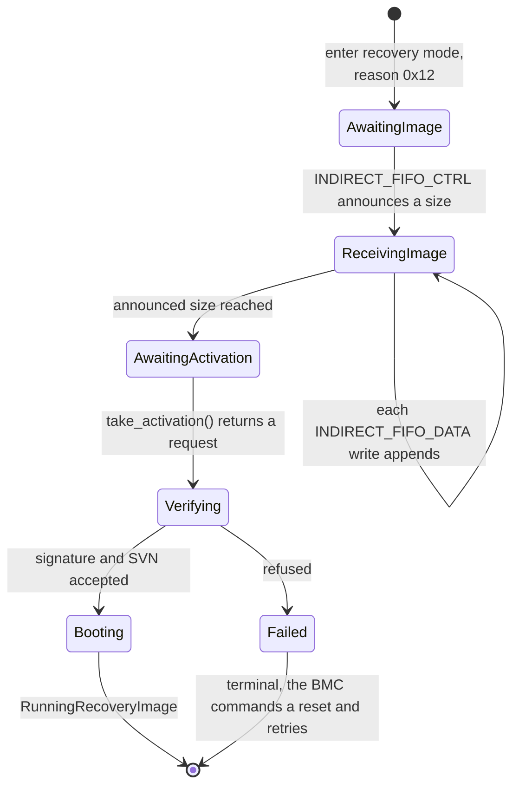
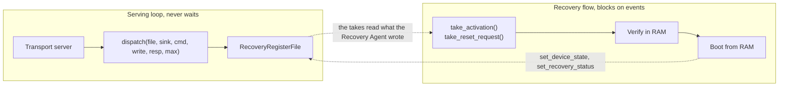

# OCP streaming boot

The eRoT serves the OCP Recovery interface as the Device, and the BMC
drives it as the Recovery Agent. The Recovery Agent pushes the bytes
and requests the activation, and the Device verifies the image and boots
or refuses it.

Streaming boot is the rung below every local image option the board has.
The eRoT tries the active slot with its retries, then whatever local
rungs the board declares, and streams an image from the BMC only when the
local options are gone. Which rungs exist is per-board configuration, not
a rule this design fixes: the image layout schema permits a golden copy.

The strap stays the bottom rung. FWSPICK is a pin the chip samples at
power-on that makes the ROM boot over UART instead of flash, so reaching
the strap means someone touches the board.

The transport binding is out of scope for this task; I3C and USB are
the primary interfaces. This design covers the transport-agnostic device
layer, which is why `dispatch` takes a command byte and a payload
and nothing else.

## The wire layer

`services/ocp-recovery/api` holds the wire layer: the command byte values
`0x22` through `0x2f`, the access rule, the accepted length and the scope
for each one, and a packed layout per register with a checked
`apply_agent_write`. A write that names an unsupported value stores
nothing, because every byte is validated before any byte is stored. The
crate defines `OCP RECV` as the `PROT_CAP` magic and version 1.1, which
the Device advertises.

`services/ocp-recovery/server` holds the register file and the dispatch
function. `RecoveryRegisterFile` holds the single copy of the register
state, `dispatch` serves one Recovery Agent read or write against it, and
`FifoSink` is the seam the streamed bytes leave through. `RamStaging<N>`
implements the seam over a fixed buffer and exposes `read_at` and `len`,
which is the shape the orchestrator reads images through.

`services/ocp-recovery/tests/agent_sequence_host.rs` drives a whole
streaming boot from the Recovery Agent side against the register file, and
pins the register semantics the diagrams below describe.

## The streaming-boot sequence

No signal from the eRoT reaches the BMC. The Recovery Agent discovers
recovery mode by polling: `DEVICE_STATUS` answers `RecoveryModeReady`
with the reason, and the heartbeat field tells a waiting Device from a
hung one. When the BMC starts polling is platform policy, outside this
design.

The host test is the executable form of this diagram. It streams an image
in chunks the size the FIFO advertises, checks the write and read indices
after every chunk, and ends on the same two terminal reads.

The Device drains each chunk inside the write that carries it, so the
FIFO reports empty with both indices equal after every push. A firmware
register file has no separate consumer to wait for, unlike silicon that
moves the data later.

## What happens to the streamed image

The eRoT verifies the streamed image in RAM and boots it from RAM, as
the Caliptra implementation this port starts from does: Caliptra verifies
the streamed image in SRAM and boots it without persisting it.
Flash-based recovery from a redundant partition, recovery from a
configured golden or recovery partition, and restoring redundant
partitions to a known-good state are out of scope, and all three describe
the write-to-flash path.

The eRoT writes nothing to flash and runs no trial boot. The recovery
path reads the SVN floor to judge the image and never advances the floor,
because a recovery boot is not an installation. If the booted image
fails, the BMC commands a reset over `DEVICE_RESET` and streams again:
a RAM image has no slot to revert to.

The verify step reuses the signature verification client seam the eRoT
has, and the SVN floor read the orchestrator performs.

Proposed mapping from the verify outcome to the two status registers;
the spec leaves the reason code to the Device, so the mapping is open to
review:

| Verify outcome | RECOVERY_STATUS state | DEVICE_STATUS state and reason |
| --- | --- | --- |
| Image authenticates and boots | `Successful` (0x3) | `RunningRecoveryImage` (0x5), no reason code |
| Signature does not verify | `AuthenticationError` (0xd) | `BootFailure` (0xe), `RecoveryFirmwareAuthFailure` (0xf) |
| Image SVN below the SVN floor | `Failed` (0xc) | `BootFailure` (0xe), `RecoveryFirmwareRollback` (0x10) |
| Image malformed or short | `Failed` (0xc) | `BootFailure` (0xe), `RecoveryFirmwareMissing` (0xe) |
| Device cannot enter recovery | `EnterRecoveryError` (0xe) | `BootFailure` (0xe), `GenericHardwareError` (0x1) |

Only `RecoveryModeReady`, `RecoveryPending` and `BootFailure` carry a
reason code; the register file stores 0 for every other state. The last
row reports the
failure through `BootFailure` rather than `FatalError`: the spec calls a
fatal error not recoverable through the OCP flow and populates no reason
code for it, so a Recovery Agent reading `FatalError` stops pushing
images. `BootFailure` carries the reason code that says what to fix.

The Recovery Agent clears a terminal state with the `DEVICE_RESET`
command: the eRoT takes the request through `take_reset_request` and
resets itself, which matches what the register file enforces:
`RECOVERY_STATUS` is read-only to the Recovery Agent, so only the Device
moves it.

## The execution model

The image that serves the OCP registers runs the recovery sequence as
its main flow, and "Which image serves the interface" below decides
which image that is. There is no separate recovery service and no
event-driven state machine: the flow runs straight through and blocks on
`take_activation` and `take_reset_request`, while the transport loop
underneath keeps serving `dispatch`.

Blocking is safe because the wire half and the policy half are split:

The BMC polls `DEVICE_STATUS` and `INDIRECT_FIFO_STATUS` and watches the
heartbeat for as long as the flow runs, so the wire half must not block
on the policy half. Caliptra spins on the same registers in a blocking
loop because it has the core to itself. The eRoT blocks on events
instead, and `tick_heartbeat` shows the BMC that the Device is alive.

Several Caliptra behaviours follow from its silicon and have no firmware
analogue: the DMA shim that moves FIFO bytes, reads from a fixed FIFO
address, the dummy mailbox lock, and hashing over AXI. The eRoT register
file is firmware state, so the bytes arrive on the same call that carries
them.

Until a streamed image verifies and boots, the recovery image holds every
downstream device in reset; holding the resets is the only work the
recovery image does beyond serving the interface.

## Which image serves the interface

Under either answer to the scope question below, the operational image
serves the interface: it carries a degraded OCP mode that it enters on
fatal paths the firmware itself detects, such as orchestrator lockdown or
a failed bring-up. Serving the interface after a fatal error is best
effort from possibly corrupted state. This mode is testable under QEMU
before any flash provisioning exists.

Whether a device supports OCP streaming belongs in the orchestrator
configuration schema under `services/orchestrator/config`, declared in
the board table in `target/<board>/devices.rs` and validated by a const
function at build time. The `PROT_CAP` capability bits, the FIFO region
size, and whether an image enters the serving flow derive from that field
at compile time. A device without the field advertises nothing, and
`dispatch` refuses the FIFO commands for it.

Whether a second image also serves it is the open question. The two
scopes and what each one costs:

**Scope A, one image.** The operational image carries the degraded mode
and nothing else serves the interface. The cost is coverage: when the
operational image does not run at all, no code inside it can serve
anything, so the ROM rejecting a corrupt image, a torn update, and slots
stranded below the SVN floor all fall through to the strap and a
technician. The gain is that no recovery copy has to be built, signed,
provisioned, write-protected or updated.

**Scope B, two images.** A second signed firmware on CS1, the recovery
copy, comes from its own composition,
`target/ast10x0/erot-recovery/system.json5`, which holds the kernel,
transport server, ocp-recovery server, verify client and the
straight-line flow, and no orchestrator or PLDM. Two Bazel targets
produce the two binaries. The AST10x0 ABR (alternate boot recovery) swap
reaches the recovery copy when the image on CS0 never signals liveness
and the watchdog flips the chip select. The cost is the second binary:
the two images share the internal 1 MB flash, the recovery copy needs its
own signing and provisioning, and rewriting a write-protected copy needs
a policy. The gain is the only coverage of the image-dead case without
physical access.

The AST1060 supports Scope B. The ABR swap fires on the FMC WDT2 timeout,
22 seconds by default, or on the external `FWSPIABR#` pin; the watchdog
is armed by OTP strap at boot and only firmware that boots successfully
disables it, so a ROM that refuses the CS0 image leaves the watchdog
counting and the swap reaches the recovery copy after the timeout. The
flash controller write-protects the recovery copy on its own: FMC00 sets
write enable per chip select, the FMCA4 write-address filters bound the
writable ranges, and the FMCA8 and FMCAC lock registers freeze that
configuration until a reset. The ROM anti-rollback counter is one 64-bit
Manifest ID in OTP, compared against every image the ROM verifies
whichever flash it boots from, so an update policy either keeps the
Manifest ID at or below the revision of the recovery copy or rewrites the
recovery copy first.

Both scopes reject one alternative: serving the interface from the ROM.
The ROM is fixed silicon, so nothing can be ported into it.

## The scope rule and the protocol-error latch

Every command carries a scope. Commands `0x22` through `0x27`, which are
`PROT_CAP`, `DEVICE_ID`, `DEVICE_STATUS`, `DEVICE_RESET`, `RECOVERY_CTRL`
and `RECOVERY_STATUS`, are always available. Commands `0x28` through
`0x2f`, which are the hardware status, the indirect window (`0x29` to
`0x2b`), the vendor command (`0x2c`) and the FIFO group (`0x2d` to
`0x2f`), belong to recovery mode only.

`dispatch` refuses a recovery-mode command outside recovery mode, with
recovery mode derived from `DEVICE_STATUS` byte 0.

A refusal changes no register except the error byte it latches.
`dispatch` validates access, length and every byte of the payload before
storing anything, latches a protocol error into `DEVICE_STATUS` byte 1,
and answers zero bytes. The latch clears when the Recovery Agent reads
`DEVICE_STATUS`, and the read returns the error that was latched before
the clear. A second error arriving before that read overwrites the first,
so the Recovery Agent sees the most recent one.

The values are the `ProtocolError` bytes in `services/ocp-recovery/api`.

"Write 1, Device Clears" names a whole-field operation here, not a
bitwise clear. The activate field in `RECOVERY_CTRL` accepts `0xf` to
activate and `0x0` for idle and refuses every other value, and the FIFO
reset field and the device reset field follow the same rule. The Device
writes the idle value back once it has acted, so a readback shows `0x0`
rather than a partially cleared value.

## Out of scope

Forced recovery is out of scope. Caliptra does not implement it, and
adopting it later costs a configuration field plus the operational image
serving the registers. The register file decodes the armed value and
keeps it across the reset take, so nothing in the wire layer has to
change.

Also out of scope: the indirect memory window and the vendor command,
which `dispatch` refuses and `PROT_CAP` does not advertise; the transport
binding; and downstream devices, whose reset lines and boot media the
eRoT drives through the orchestrator rather than through this interface.

## Open questions

One question blocks the rest.

**Must streaming boot cover the case where the operational image does not
run at all, without physical access?** Covering the cases in Scope A
requires something bootable outside the operational image, and the only
candidate besides the ROM and the strap is the recovery copy reached by
the ABR swap. The answer picks Scope A or Scope B in "Which image serves
the interface", and under Scope B it also decides what the recovery copy
contains: a full firmware that carries the degraded mode, a minimal
recovery-only image, or a per-board choice.

Smaller questions:

- What update policy governs the recovery copy? Rewriting it means
  lifting the write protection, which is the same capability an attacker
  needs, so who may do it, with what authorization and in what setting is
  a platform decision this design does not take. The policy also has to
  keep the OTP Manifest ID at or below the revision of the recovery copy,
  or rewrite the recovery copy before advancing the Manifest ID.
- Can the BMC reset the eRoT when the booted image stops serving the
  interface? The in-band `DEVICE_RESET` needs a serving dispatch, so the
  hung-image case needs `FWSPIABR#`, a reset line, or the strap.
- Board wiring: whether a BMC GPIO drives `FWSPIABR#`, which forces the
  recovery copy to boot with nothing serving the interface, and whether a
  reset line reaches the eRoT.
- One bench test confirms the ROM failure path does not stop FMC WDT2, so
  a refused CS0 image reaches the recovery copy without help.
- Forced recovery stays out of scope unless review raises it.
